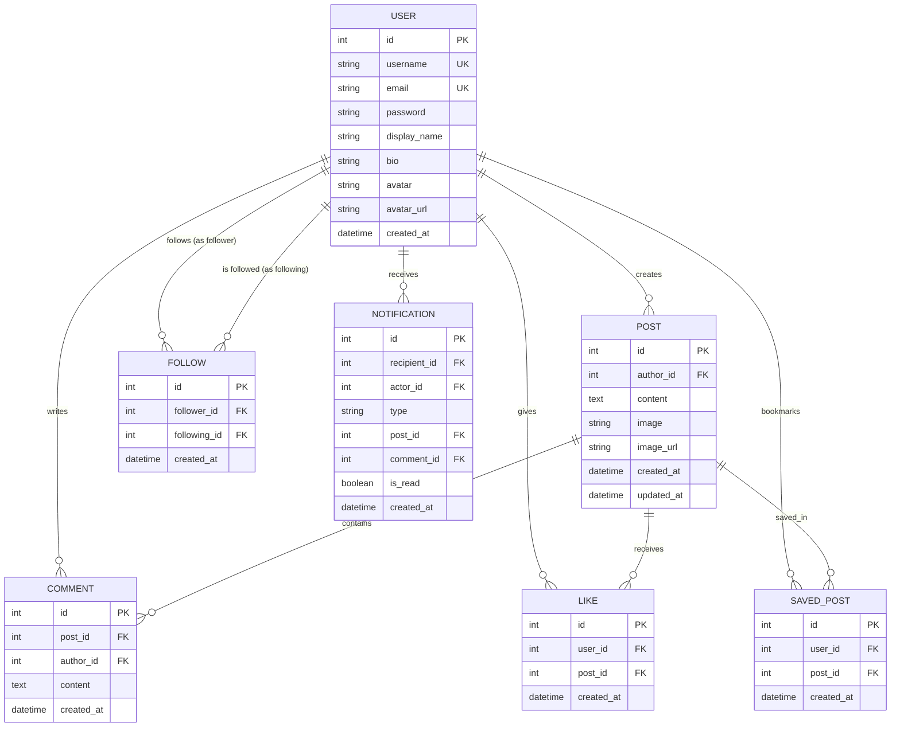

 🌿 NOOK — A Cozy & Mindful Social Media Platform

<p align="center">
  
  
  
  
  
  
  
</p>

<p align="center">
  <strong>NOOK</strong> is a clean, modern, responsive full-stack social media platform engineered for mindful sharing, warm community conversations, and creative expression. Built with a <strong>Django 5 & Django REST Framework</strong> backend, paired with an interactive <strong>Vanilla JavaScript Single Page Application (SPA)</strong> frontend.
</p>

<p align="center">
  
</p>

---

## 📑 Table of Contents

- [Overview](#-overview)
- [Key Features](#-key-features)
- [Design System & Aesthetics](#-design-system--aesthetics)
- [Architecture & Database Schema](#-architecture--database-schema)
- [Tech Stack](#-tech-stack)
- [Getting Started](#-getting-started)
  - [Prerequisites](#prerequisites)
  - [Installation & Setup](#installation--setup)
  - [Seeding Demo Data](#seeding-demo-data)
  - [Running the App](#running-the-app)
- [Demo Credentials](#-demo-credentials)
- [RESTful API Reference](#-restful-api-reference)
- [Testing & Quality Assurance](#-testing--quality-assurance)
- [Project Directory Structure](#-project-directory-structure)
- [Pushing to GitHub](#-pushing-to-github)
- [Author & Acknowledgements](#-author--acknowledgements)
- [License](#-license)

---

## 🌿 Overview

Traditional social media platforms are often cluttered, noisy, and overwhelming. **NOOK** re-imagines digital interaction by offering a peaceful, cozy, and aesthetically pleasing sanctuary for reading, journaling, sharing photography, and connecting thoughtfully.

Whether you're sharing a snapshot of your morning coffee, writing reflections on a book, or following creators you admire, NOOK provides a friction-free experience with instant micro-interactions, responsive design across mobile and desktop, and a calming color palette.

---

## ✨ Key Features

### 🎨 Mindful & Cozy UI Experience
- **Dual Theme Support:** Toggle effortlessly between **Airy Lilac (Light Mode)** and **Midnight Plum (Dark Mode)** with system persistence.
- **Glassmorphism & Micro-Interactions:** Heart bounce animations on likes, smooth modal transitions, responsive drawer menus, and soft rounded elevation cards.
- **Responsive Layout:** Adaptive desktop triple-column view (Navigation, Main Feed, Discovery Sidebar) and mobile bottom navigation bar.

### 📰 Dynamic Feeds & Discovery
- **Multi-Tab Feed Switching:**
  - 🌟 **For You:** Global reverse-chronological feed featuring posts from the entire community.
  - 👥 **Following:** Curated feed showing content exclusively from accounts you follow.
  - 💖 **Liked Posts:** Quick access to all posts you've shown love to.
  - 🔖 **Bookmarks:** Private collection of saved posts for later inspiration.
- **Real-Time Search:** Search users and post content seamlessly.

### ✍️ Rich Post Creation & Media
- Create posts with markdown-friendly text content and optional imagery.
- Support for direct image uploads as well as high-resolution external media URLs.
- Built-in **Lightbox Zoom Modal** for immersive photo viewing.

### 💬 Social Graphs & Community Interaction
- **Interactive Likes:** Instant like/unlike toggling with animated heart feedback and live count updates.
- **Comment Threads:** Engage in meaningful discussions with inline comments and author deletion rights.
- **Follow / Unfollow System:** Follow favorite creators with real-time follower/following count synchronization.
- **Suggested Accounts:** Intelligent discovery sidebar recommending active creators to follow.

### 🔔 Notifications & User Settings
- **Live Notification Hub:** Receive real-time alerts whenever another user likes your post, comments, or follows you.
- **Interactive Unread Badges:** Dynamic notification pill that updates in real time and supports 1-click "Mark All as Read".
- **Customizable Profiles:** Edit your display name, bio, and avatar.
- **Account Security:** Update passwords securely with backend validation.

### ⚡ 1-Click Demo Accounts
- Built-in switcher to instantly log in as 4 distinct creator personas without typing passwords, perfect for evaluations and live demos!

---

## 🎨 Design System & Aesthetics

The UI typography is powered by **Plus Jakarta Sans** with a carefully curated, low-fatigue palette:

| Element / Interaction | Hex Code | Visual Sample | Usage in Application |
|---|---|---|---|
| **Primary Brand / CTA** | `#8B72D9` | `■` | Primary buttons, active navigation states, author badges |
| **Like / Heart State** | `#D56A91` | `■` | Liked heart animation, active heart icons, engagement counters |
| **Success / Positive** | `#A8CDB5` | `■` | Success toasts (*"Posted!"*, *"Saved to bookmarks"*), confirmation tags |
| **Stories & Highlights** | `#F4D9A6` | `■` | Story rings, special accents, creator highlights |
| **Light Mode Background** | `#FAF8FF` | `■` | Soft Airy Lilac base background |
| **Dark Mode Background** | `#211C2B` | `■` | Deep Midnight Plum dark theme base |

---

## 🏗️ Architecture & Database Schema

NOOK uses a normalized relational database design with complete integrity constraints (preventing duplicate likes, follows, or bookmarks):



---

## 🛠️ Tech Stack

### Backend
- **Python 3.10+**
- **Django 5.0+** — Robust MVT framework providing ORM, authentication, and routing.
- **Django REST Framework (DRF)** — RESTful API serialization, viewsets, and JSON responses.
- **django-cors-headers** — Secure cross-origin resource handling.
- **Pillow** — High-performance image processing and avatar handling.
- **SQLite** — Lightweight relational database (zero configuration required, production-ready for PostgreSQL).

### Frontend
- **Vanilla JavaScript (ES6+)** — Single Page Application (SPA) architecture with dynamic DOM rendering and Fetch API.
- **Semantic HTML5** — Accessible and SEO-friendly layout.
- **Pure Modern CSS3** — CSS custom properties (variables), Grid, Flexbox, glassmorphic backdrop filters, and keyframe animations.
- **Google Fonts** — *Plus Jakarta Sans* for contemporary readability.

---

## 🚀 Getting Started

Follow these step-by-step instructions to get NOOK running locally on your computer.

### Prerequisites
- **Python 3.10 or higher** installed on your system ([Download Python](https://www.python.org/downloads/))
- **Git** installed ([Download Git](https://git-scm.com/))

---

### Installation & Setup

#### 1. Clone the Repository
```bash
git clone https://github.com/mudrapethkar/CodeAlpha_SocialMediaPlatform.git
cd CodeAlpha_SocialMediaPlatform
```

#### 2. Create and Activate a Virtual Environment

- **On Windows (Command Prompt / PowerShell):**
  ```bash
  python -m venv venv
  .\venv\Scripts\activate
  ```

- **On macOS / Linux:**
  ```bash
  python3 -m venv venv
  source venv/bin/activate
  ```

#### 3. Install Dependencies
```bash
python -m pip install --upgrade pip
pip install -r requirements.txt
```

#### 4. Run Database Migrations
```bash
python manage.py makemigrations nook_app
python manage.py migrate
```

#### 5. Seed the Database with Realistic Demo Data
NOOK includes a custom management command that populates the database with realistic demo users, avatars, posts, comments, likes, and social relationships:
```bash
python manage.py seed_data
```

#### 6. Start the Local Development Server
```bash
python manage.py runserver 127.0.0.1:8080
```

Now, navigate to **[http://127.0.0.1:8080/](http://127.0.0.1:8080/)** in your web browser!

---

## 👥 Demo Credentials

You can test the application instantly using the **1-Click Demo Login** bar located in the app, or enter credentials manually:

| Username | Display Name | Persona / Bio | Password |
|---|---|---|---|
| `maya_reads` | Maya Lin | 📖 Cozy reader, specialty coffee lover & morning thinker | `nook123` |
| `leo_creates` | Leo Vance | 🎨 Digital product designer, photographer & UI creator | `nook123` |
| `chloe_bakes` | Chloe Martin | 🥖 Artisan sourdough baker & pastry chef in Portland | `nook123` |
| `alex_dev` | Alex Rivers | 💻 Full-stack developer building open-source tools | `nook123` |
| `admin` | Admin Nook | 🛡️ Platform Superuser (Access Django Admin at `/admin/`) | `admin123` |

---

## 📡 RESTful API Reference

The backend exposes clean, structured REST API endpoints:

### 🔐 Authentication
| Method | Endpoint | Description |
|---|---|---|
| `POST` | `/api/auth/register/` | Register a new user account |
| `POST` | `/api/auth/login/` | Authenticate with username/email & password |
| `POST` | `/api/auth/demo-login/` | 1-Click login as a demo persona |
| `POST` | `/api/auth/logout/` | Terminate session |
| `GET` | `/api/auth/me/` | Fetch current session & unread notification count |

### 👤 Profiles & Relationships
| Method | Endpoint | Description |
|---|---|---|
| `GET` | `/api/users/<username>/` | Retrieve public profile, follower/following/post counts |
| `PATCH` | `/api/users/me/` | Update profile display name, bio, and avatar |
| `POST` | `/api/users/<username>/follow/` | Toggle follow / unfollow on a user |
| `GET` | `/api/users/<username>/followers/` | Retrieve user's follower list |
| `GET` | `/api/users/<username>/following/` | Retrieve user's following list |
| `GET` | `/api/users/suggested/` | Retrieve recommended accounts to follow |

### 📝 Posts, Comments & Engagements
| Method | Endpoint | Description |
|---|---|---|
| `GET` | `/api/posts/` | Query posts (`?feed=for_you`, `?feed=following`, `?saved=true`, `?liked=true`, `?search=`) |
| `POST` | `/api/posts/` | Publish a new post with text and optional image |
| `GET` | `/api/posts/<id>/` | Fetch single post with full comments |
| `DELETE` | `/api/posts/<id>/` | Delete author's post |
| `POST` | `/api/posts/<id>/like/` | Toggle like/unlike with dynamic count update |
| `POST` | `/api/posts/<id>/save/` | Bookmark or unbookmark a post |
| `GET` | `/api/posts/<id>/comments/` | Fetch all comments for a post |
| `POST` | `/api/posts/<id>/comments/` | Add a comment to a post |
| `DELETE` | `/api/comments/<id>/` | Delete comment (by comment author or post author) |

### 🔔 Notifications & Settings
| Method | Endpoint | Description |
|---|---|---|
| `GET` | `/api/notifications/` | Retrieve user's notifications with actor details |
| `POST` | `/api/notifications/mark-read/` | Mark all notifications as read |
| `POST` | `/api/settings/password/` | Change account password securely |

---

## 🧪 Testing & Quality Assurance

NOOK comes with a comprehensive automated test suite (`test_suite.py`) testing the entire end-to-end user workflow:

```bash
# Ensure server is running on port 8080, then in a separate terminal:
python test_suite.py
```

### Verified Test Suite Checks:
- [x] **HTML Root Route & Branding Verification**
- [x] **Static CSS Delivery & Color Token Integrity**
- [x] **Unauthenticated Guest State Handling**
- [x] **Demo Authentication & Session Cookie Management**
- [x] **Session Persistence Across API Calls**
- [x] **Post Creation with Image URLs & Text**
- [x] **Interactive Post Liking & State Toggling**
- [x] **Threaded Comment Creation & Retrieval**
- [x] **Post Bookmarking / Saved Feeds**
- [x] **Follow / Unfollow Social Graph Toggling**
- [x] **User Profile Metadata & Follower Metrics**
- [x] **Notification Generation for Social Actions**
- [x] **Reverse-Chronological Feed Filtering**

---

## 📁 Project Directory Structure

```plaintext
CodeAlpha_SocialMediaPlatform/
├── manage.py                     # Django management script
├── requirements.txt              # Project dependencies
├── test_suite.py                 # Automated end-to-end verification test suite
├── README.md                     # Project documentation
│
├── nook_backend/                 # Core Django project configuration
│   ├── __init__.py
│   ├── asgi.py
│   ├── settings.py               # Django settings (CORS, Static, Media, Auth)
│   ├── urls.py                   # Root URL dispatcher & SPA fallback routing
│   └── wsgi.py
│
├── nook_app/                     # Main social media application
│   ├── admin.py                  # Django Admin models registration
│   ├── apps.py
│   ├── models.py                 # Data models (User, Post, Like, Comment, Follow, etc.)
│   ├── serializers.py            # DRF Serializers for JSON serialization
│   ├── urls.py                   # REST API routes
│   ├── views.py                  # API views & controller logic
│   └── management/
│       └── commands/
│           └── seed_data.py      # Demo database seeder
│
├── static/                       # Static assets
│   ├── css/
│   │   └── style.css             # Design tokens, themes, layouts & animations
│   ├── js/
│   │   ├── api.js                # Asynchronous API wrapper & CSRF handler
│   │   └── app.js                # Frontend SPA controller & view renderer
│   └── img/                      # Media and icons
│
└── templates/                    # HTML Templates
    └── index.html                # Single Page Application root HTML
```

---

## 📤 Pushing to GitHub

To push this project to your GitHub account:

```bash
# 1. Initialize git (if not already done)
git init

# 2. Stage all files
git add .

# 3. Create your first commit
git commit -m "feat: complete full-stack social media platform NOOK"

# 4. Set default branch to main
git branch -M main

# 5. Link your GitHub remote repository
git remote add origin https://github.com/mudrapethkar/CodeAlpha_SocialMediaPlatform.git

# 6. Push code to GitHub
git push -u origin main
```

---

## 👩‍💻 Author & Acknowledgements

- **Developer:** [Mudra Pethkar](https://github.com/mudrapethkar)
- **Email:** [mhpethkar@gmail.com](mailto:mhpethkar@gmail.com)
- **Internship:** Developed as part of the **CodeAlpha Internship Program** for the **Social Media Platform** project assignment.

---

## 📄 License

This project is licensed under the [MIT License](LICENSE) — feel free to explore, learn from, and adapt for educational purposes.


